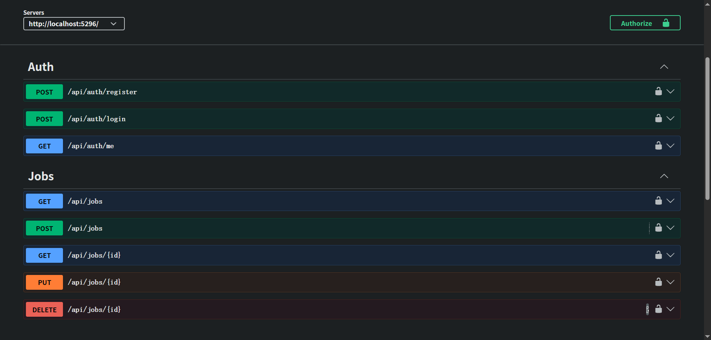

# MatchHire (.NET)

A job board REST API built with **C#, ASP.NET Core, EF Core and SQL Server**.

This is a .NET version of the auth and job modules from my Java project,
[MatchHire](https://github.com/xjfdy/matchhire-system) (Spring Boot microservices with gRPC, Kafka and Kubernetes).
I built it to learn the .NET stack.



## Tech stack

| Area | Technology |
|---|---|
| Language / runtime | C# 14, .NET 10 |
| Web API | ASP.NET Core (controllers) |
| Database | SQL Server 2022 (Docker), EF Core 10 with migrations |
| Auth | JWT bearer tokens, BCrypt password hashing |
| Docs | OpenAPI + Swagger UI |
| Tests | xUnit, EF Core InMemory, `WebApplicationFactory` |

## Features

**Auth**
- Register as a `Candidate` or `Employer`
- Log in and receive a JWT (valid for 60 minutes)
- `GET /api/auth/me` returns the current user

**Jobs**
- Anyone can browse and search jobs (title, remote, job type, salary) with pagination
- Only employers can create jobs
- Only the employer who posted a job can update or delete it

## Security

| Concern | How it's handled |
|---|---|
| Passwords | Hashed with BCrypt, never returned by the API |
| Identity | The user ID always comes from the verified JWT, never from the request body or URL |
| Authorization | Role check (`[Authorize(Roles = "Employer")]`) plus an ownership check in the service, returning 403 |
| User enumeration | Wrong password and unknown email return the same 401 and message |
| Brute force | Login is rate limited to 5 attempts per minute per IP (429 after that) |
| Secrets | JWT key and connection string are kept in .NET User Secrets, not in the repo |
| Input validation | Data annotations plus cross-field rules (max salary ≥ min salary); page size capped at 50 |
| SQL injection | All queries go through EF Core LINQ, which uses parameters |
| Data integrity | Unique index on email, foreign key from jobs to users |
| Error handling | A global exception handler returns consistent `ProblemDetails` and hides internal errors |

## Java → .NET

| Java version | This project |
|---|---|
| Spring Boot | ASP.NET Core |
| Spring Data JPA / Hibernate | EF Core |
| `ddl-auto=update` | EF Core migrations |
| `@RestControllerAdvice` | `IExceptionHandler` |
| `@Validated` + Bean Validation | `[ApiController]` + data annotations |
| JPA Specifications | LINQ `IQueryable` |
| Gateway `JwtAuthFilter` + `X-User-Id` header | JWT bearer middleware + `User.GetUserId()` |
| JUnit + Mockito + MockMvc | xUnit + EF Core InMemory + `WebApplicationFactory` |

## Getting started

**Requirements:** .NET 10 SDK, Docker

1. Start SQL Server

   ```bash
   docker run -e "ACCEPT_EULA=Y" -e "MSSQL_SA_PASSWORD=<your-password>" -p 1433:1433 --name matchhire-sql -d mcr.microsoft.com/mssql/server:2022-latest
   ```

2. Set the secrets (from the `MatchHire.Api` folder)

   ```bash
   dotnet user-secrets set "ConnectionStrings:Default" "Server=localhost,1433;Database=MatchHireDb;User Id=sa;Password=<your-password>;TrustServerCertificate=True"
   dotnet user-secrets set "Jwt:Key" "<a random string of at least 32 characters>"
   ```

3. Create the database and run the API

   ```bash
   dotnet tool install --global dotnet-ef
   dotnet ef database update
   dotnet run
   ```

4. Open Swagger at `http://localhost:5296/swagger`. Log in, click **Authorize**, and paste the token.

## API

| Method | Endpoint | Access |
|---|---|---|
| POST | `/api/auth/register` | Public |
| POST | `/api/auth/login` | Public, rate limited |
| GET | `/api/auth/me` | Logged in |
| GET | `/api/jobs?title=&remote=&jobType=&minSalary=&page=&size=` | Public |
| GET | `/api/jobs/{id}` | Public |
| POST | `/api/jobs` | Employer |
| PUT | `/api/jobs/{id}` | Employer who posted the job |
| DELETE | `/api/jobs/{id}` | Employer who posted the job |

## Tests

```bash
dotnet test
```

- **Unit tests** for `AuthService` and `JobService`: password hashing, duplicate email, same error for wrong password and unknown email, ownership checks, search and pagination, salary validation
- **API tests** that start the whole app in memory with `WebApplicationFactory`: 401 without a token, 403 for candidates, 201 for employers, 429 after 5 login attempts

## Project structure

```
MatchHire.Api/
├── Auth/          User entity, DTOs, AuthService, JwtTokenService
├── Jobs/          Job entity, DTOs, JobService
├── Controllers/   AuthController, JobsController
├── Common/        Exceptions, global exception handler, helpers
├── Data/          AppDbContext
├── Migrations/    EF Core migrations
└── Program.cs     DI, JWT, rate limiting, Swagger
MatchHire.Tests/   xUnit tests
```

## What I would add next

- Applications module (candidates apply to jobs, employers review them)
- Refresh tokens and token revocation
- GitHub Actions running `dotnet test` on every push
- Integration tests against a real SQL Server using Testcontainers
- Dockerfile and deployment to Azure App Service with Azure SQL